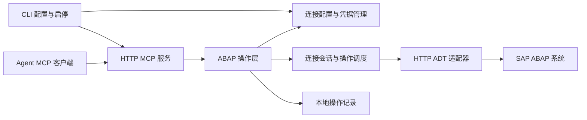

# SAP MCP 第一版架构设计

日期：2026-10-13  
状态：第一版已实现并通过本地模拟测试，待真实 SAP 系统联调。本文描述目标设计；实际支持范围和差异见 README。

## 1. 目标与范围

构建不依赖 VS Code 的本地 CLI 应用，通过 HTTP ADT 访问 SAP ABAP 系统，并向 agent 提供 Streamable HTTP MCP tools。

第一版包括：

- 手动配置多个 SAP 连接，测试登录并探测 ADT 能力。
- HTTP MCP 服务及本地访问令牌认证。
- 搜索对象、浏览包、读取源码。
- 创建可执行 REPORT 程序、修改源码、语法检查和显式激活。
- 对象锁、版本冲突、传输请求和部分失败处理。

第一版不包含桌面应用、Web 页面、stdio MCP、SAP GUI 配置解析、RFC、SAProuter、SNC/SSO、调试、任意 ABAP 执行、删除对象或释放传输请求。

## 2. 总体架构



采用单进程模块化结构，不拆分微服务。CLI 启动服务后，各连接按需建立独立 SAP 会话。MCP 会话不等于 SAP 会话，不向 agent 暴露 SAP cookie、CSRF token 或锁句柄。

建议技术栈：TypeScript、Node.js、官方 MCP TypeScript SDK、`abap-adt-api`。前者用于协议处理，后者作为可替换的 ADT 适配器依赖；业务层不直接依赖其数据结构。具体依赖版本及凭据库在实现阶段验证并锁定。

| 模块 | 职责 |
| --- | --- |
| CLI | 交互输入、隐藏密码、配置管理、连通性测试、服务生命周期 |
| 配置与凭据 | 持久化非敏感配置，按连接 ID 访问 Windows 凭据管理器 |
| MCP 层 | 协议协商、认证、参数验证、tools 注册、统一结果转换 |
| ABAP 操作层 | 对象语义、写入策略、版本校验、错误分类、操作记录 |
| 会话与调度 | SAP 登录状态、会话过期、并发控制、锁生命周期 |
| ADT 适配器 | discovery、媒体类型与能力适配、HTTP 请求和响应解析 |

## 3. 连接模型

| 字段 | 含义 |
| --- | --- |
| `connection_id` | 稳定内部 ID，重命名连接不改变它 |
| `name` | 用户定义的唯一名称，例如 dev |
| `base_url` | SAP HTTP 地址，例如 http://sap-host:8000 |
| `client` | 三位数字字符串，例如 001，保留前导零 |
| `username` | SAP 用户名 |
| `language` | ADT 登录语言参数，例如 EN；按后端支持验证 |
| `credential_ref` | 凭据引用，不包含密码 |
| `write_enabled` | 默认 false，由本地配置显式启用 |
| `allowed_packages` | 允许写入的包；启用写入时要求明确配置 |

第一版只使用 HTTP ADT。`base_url` 不含用户名、密码、查询参数和 fragment；CLI 可接受末尾 `/sap/bc/adt` 并规范化，其他自定义反向代理路径暂不支持。端口由用户填写，不根据系统号推算。

配置建议存放在 `%APPDATA%\sap-mcp\config.json`，含 `schema_version`。密码按稳定连接 ID 保存至 Windows 凭据管理器，更新配置采用原子替换。删除连接时清理其凭据；运行期间有操作的连接不能删除或重新配置。

HTTP Basic 凭据和代码流量没有 TLS 加密，第一版部署限定在用户认可的可信网络；HTTP 客户端不向其他 origin 转发认证信息。后续 HTTPS 支持仍通过同一适配器扩展。

## 4. CLI 设计

以下命令已实现；实际执行方式和环境要求见项目 README。

| 命令 | 行为 |
| --- | --- |
| `sap-mcp connection add dev` | 交互填写连接，隐藏输入密码 |
| `sap-mcp connection list` | 列出连接和配置完整性，不自动登录所有系统 |
| `sap-mcp connection edit dev` | 修改配置或更新凭据 |
| `sap-mcp connection remove dev` | 删除配置和关联凭据 |
| `sap-mcp connection test dev` | 验证网络、登录、discovery 和后端能力 |
| `sap-mcp token create` | 生成高熵 MCP 令牌，明文仅输出一次 |
| `sap-mcp token revoke <token-id>` | 撤销指定令牌 |
| `sap-mcp serve --port 8765` | 前台启动服务，固定监听 127.0.0.1 |

连接测试是只读操作，不通过创建程序测试权限。输出应区分网络失败、登录失败、ADT 未启用、授权不足和能力不支持。成功读取不代表具有写入权限。

密码不接受命令行明文参数。凭据存储失败必须报告，不回退到配置文件明文存储。首次版本要求 Windows 凭据管理器可用。

## 5. MCP HTTP 服务

- 端点：`http://127.0.0.1:8765/mcp`，端口可配置。
- 传输：Streamable HTTP，使用官方 SDK，支持初始化及协议版本协商。
- 认证：`Authorization: Bearer <token>`；服务端存储令牌校验值，不保存令牌明文。
- 网络：第一版不开放局域网绑定；校验 Host 和 Origin，拒绝不可信浏览器来源。
- 会话：协议会话不是认证凭据，每个请求仍需认证。
- HTTP 行为：按 SDK 实现 POST、GET 和 DELETE；未提供 GET 事件流时按规范返回 405。
- 限制：设置请求体大小、搜索数量、源码大小、并发和超时上限。

令牌授予访问此服务中已配置连接的能力；第一版不实现逐令牌的连接授权。连接本身的写入开关和包范围始终由服务端执行。agent 不能用 tools 修改连接、凭据、令牌或写入策略。

服务在前台运行，收到退出信号后停止接收新请求，等待在途操作并清理锁。日志与配置输出不得泄露密码、认证头、cookie 或 CSRF token。

## 6. MCP Tools 契约

除 `list_connections` 外，所有操作必须提供 `connection_id`，不使用隐式当前系统。对象 URI 从查询结果获得；只允许当前连接下合法 ADT 相对路径，禁止外部 URL、目录穿越或任意 HTTP 请求。

| Tool | 主要参数 | 主要结果 |
| --- | --- | --- |
| `list_connections` | 无 | ID、名称、配置状态、写入策略摘要 |
| `get_capabilities` | `connection_id` | discovery 支持的能力及探测时间 |
| `search_objects` | 连接、`query`、可选类型、`limit` | 名称、类型、包、对象 URI、是否截断 |
| `list_package_objects` | 连接、`package_name`、可选 `cursor`、`limit` | 对象和可用的后续游标 |
| `read_source` | 连接、`object_uri`、可选 `source_uri`、`version` | 源码、源码 URI、实际版本、revision、哈希 |
| `create_program` | 连接、`name`、`description`、`package_name`、可选 `transport_task`、`request_id` | 对象 URI、创建状态 |
| `update_source` | 连接、`source_uri`、`source`、`expected_revision`、可选 `transport_task`、`request_id` | 保存状态、新 revision、inactive 状态 |
| `syntax_check` | 连接、`object_uri`、`version` | 是否通过、结构化诊断 |
| `activate_objects` | 连接、对象 URI 与预期 revision 列表、`request_id` | 各对象结果及部分失败信息 |
| `list_transport_requests` | 连接、可选状态过滤 | 当前用户可用请求、任务、状态 |

`version` 使用 `active` 或 `inactive`；不存在指定版本时明确返回错误，不静默切换版本。`revision` 是服务封装的不透明值，包含版本上下文；源码 SHA-256 用于补充校验，不作为历史恢复承诺。

分页依据后端能力实现。后端不支持完整分页时返回 `truncated`，不伪造完整遍历；服务游标必须绑定连接、查询和结果上下文。

所有结果包含 `operation_id`、`status`、`completed_steps`、`data`，失败包含 `error`。写入结果还包含 `outcome`：`confirmed`、`partial` 或 `unknown`。MCP 通过 SDK 的结构化结果承载，工具失败设置 `isError`；参数及协议错误使用对应协议错误。

诊断包括 severity、消息、对象或源码 URI、可用的位置。对外位置统一使用 1-based 行列，转换方式通过真实后端验证；无法映射的位置不编造。

## 7. SAP 会话与能力

连接首次使用时建立 SAP HTTP 会话，调用 ADT discovery 并缓存能力。cookie、CSRF token 和认证状态按连接隔离。

媒体类型、对象链接和功能支持通过 discovery 与对象元数据决定，不因某版本号就假定全功能可用。锁操作需要同一 SAP 会话上下文；对同一连接的写入及其相关检查，第一版采用串行执行。读取不会改变写入会话的会话模式。

CSRF 获取和更新由适配器处理。只有明确尚未执行的请求才可安全重试；网络超时不能直接解释为写入失败。若会话失效发生在持锁期间，先核实操作结果和锁状态，不自动换会话继续写入。

## 8. 对象创建、保存与激活

### 8.1 创建程序

第一版创建可执行 REPORT 的对象壳，不把创建、写入源码和激活合并成一次不可分割操作。

验证连接写入策略、命名、目标包、对象不存在及传输任务，再通过 ADT 创建对象，返回真实 URI。远程创建存在竞态，以 SAP 返回为准。`$TMP` 是否无需传输任务由后端确认；其他包要求有效任务，服务不自动创建或释放传输请求。

创建成功后 agent 使用返回 URI 读取初始源码，再调用修改与激活。后续失败不自动删除已创建对象。

### 8.2 保存源码

```text
验证输入、连接写入开关、对象所属包和传输任务
→ 获取 SAP 对象锁
→ 在锁内重读目标源码并核对 expected_revision
→ 通过 ADT 保存 inactive 源码
→ 读回确认并生成新 revision
→ 释放锁
→ 返回已完成步骤与最终状态
```

后端支持可靠 ETag 条件写入时使用条件请求；否则在有效锁内比较源码哈希。同一对象的源码片段共享对象级锁。预期版本不一致时不写入，返回 `VERSION_CONFLICT`。

保存与语法检查分开：保存成功不等于语法通过，也不等于激活。锁释放在 finally 路径执行；解锁失败不能覆盖已经成功保存的事实。

### 8.3 语法检查与激活

语法检查针对明确版本调用后端支持的检查能力，返回结构化诊断。激活是独立写操作，核对提交的 inactive revision，必要时在锁或后端等效一致性机制下执行。

多对象激活不承诺原子性。结果逐对象报告；激活失败保留后端实际状态。服务不激活与本次请求无关的全部 inactive 对象。版本一致性机制若后端不支持，应报告限制而不是假定无并发风险。

## 9. 错误与恢复

| 错误码 | 含义与恢复方式 |
| --- | --- |
| `AUTH_FAILED` | 更新本地凭据，再测试连接 |
| `AUTHORIZATION_DENIED` | SAP 权限不足，返回脱敏的后端原因 |
| `ADT_UNAVAILABLE` | 连接地址或 ADT 服务不可用 |
| `CAPABILITY_UNSUPPORTED` | 当前后端不支持该操作 |
| `WRITE_DISABLED` | 本地连接未启用写入 |
| `PACKAGE_NOT_ALLOWED` | 对象所在包不在允许范围 |
| `OBJECT_NOT_FOUND` / `OBJECT_EXISTS` | 读取不存在对象或创建冲突 |
| `OBJECT_LOCKED` | 返回可获取的锁信息，不强制解锁 |
| `VERSION_CONFLICT` | 重读目标版本，再生成修改 |
| `TRANSPORT_REQUIRED` / `TRANSPORT_INVALID` | 提供有效传输任务 |
| `SYNTAX_CHECK_FAILED` | 返回后端诊断，不自动撤销保存 |
| `ACTIVATION_FAILED` | 返回逐对象结果和实际完成阶段 |
| `LOCK_CLEANUP_FAILED` | 明确主操作是否成功，并记录待清理锁 |
| `OUTCOME_UNKNOWN` | 写请求超时或连接中断，读回核实后再决定重试 |

写操作带客户端 `request_id`。服务在内存中维护请求摘要、执行状态和已确认结果，相同 ID 与不同参数冲突；同一运行周期内重复请求返回已确认结果，在途重复请求不得再次执行。该索引随进程退出清空，第一版不从日志重建重复请求索引。进程重启或网络中断后的未知结果必须查询 SAP 重新核实，不承诺跨 SAP 与本地记录的 exactly-once。

进程被强制终止时锁清理无法保证。操作记录应保留可用于核实的连接、对象、完成阶段和清理状态，不提供强制解锁或自动回滚工具。

## 10. 本地数据与操作记录

非敏感连接配置为 JSON；第一版写操作记录使用 JSONL 日志文件，不引入数据库。建议存放在 `%LOCALAPPDATA%\sap-mcp\logs`，使用 UTF-8 编码，每行一个完整 JSON 对象。每个操作阶段追加一条事件，不修改已有行。事件包含 schema_version、operation_id、request_id、连接 ID、对象 URI、UTC 时间、事件类型、完成阶段、前后 revision 和错误类别；尚未取得的信息可以省略。

日志写入由单一队列串行处理，按日期和大小轮转。进程异常退出可能留下不完整的最后一行，读取时应忽略并报告该行。首个写操作事件无法记录时，在发出 SAP 写请求前返回日志错误；SAP 已执行后日志写入失败时，仍返回已知 SAP 结果并附加日志失败信息，不能把它当作可直接重试的 SAP 操作失败。

JSONL 用于排查问题和人工核实操作阶段，不作为 SAP 状态的权威来源，也不用于跨重启的重复请求识别。重启后不自动重放写操作。需要持久化查询和跨重启的请求管理时，再评估 SQLite。

默认不记录完整源码、密码或后端原始响应。源码缓存第一版可只存在内存，按连接、对象和版本隔离；修改后失效相关缓存。操作记录不是备份，历史版本恢复留待后续设计。

## 11. 实现阶段与验收

### 阶段一：连接基础

实现 CLI、配置校验、Windows 凭据存储、HTTP ADT 连接和 discovery。通过真实系统只读测试确认网络、Client、语言、认证和能力。

### 阶段二：只读 HTTP MCP

实现本机监听、令牌认证、协议初始化、连接列表、搜索、包浏览和源码读取。通过真实 MCP 客户端验证 tools/list 与 tools/call，同时验证错误凭据、无效 URI 和跨连接隔离。

### 阶段三：写入闭环

在指定测试包创建 REPORT，读取初始源码、修改 inactive 版本、检查语法、激活、读回 active 版本。验证锁冲突、版本冲突、传输任务错误、语法失败和激活失败。

模拟后端验证写请求超时、读回确认、取消请求、解锁失败和进程退出；真实 SAP 验证后端媒体类型、锁会话和状态语义。未完成真实联调前，只能声明本地协议或模拟测试通过。

## 12. 待确认事项

- 测试系统 HTTP ADT URL、Client、用户名和语言；密码仅在本地输入。
- SAP_BASIS 版本及 discovery 实际支持的功能。
- 可读取的程序和允许创建 REPORT 的测试包。
- 非 `$TMP` 包所需的有效传输任务与权限。
- agent 客户端是否支持 Streamable HTTP 及 Bearer 请求头配置。
- ADT 库在该系统上的 active/inactive、ETag、锁、检查和激活行为。

## 13. 参考资料

- [abap-adt-api：独立 ADT 客户端库](https://github.com/marcellourbani/abap-adt-api)
- [ADT 客户端接口源码](https://github.com/marcellourbani/abap-adt-api/blob/master/src/AdtClient.ts)
- [MCP Streamable HTTP 传输规范](https://modelcontextprotocol.io/specification/2025-11-25/basic/transports)
- [SAP ADT 后端配置指南](https://help.sap.com/doc/2e65ad9a26c84878b1413009f8ac07c3/201909.001/en-US/config_guide_system_backend_abap_development_tools.pdf)

上述参考用于接口和协议依据，不表示本应用具有 SAP 官方支持，也不替代目标系统上的兼容性验证。
