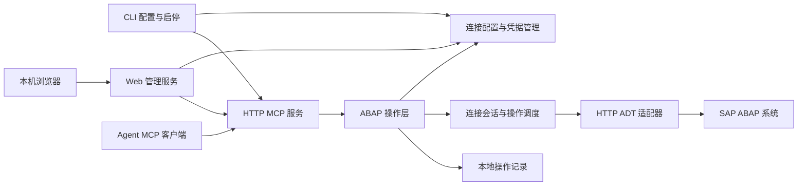

# SAP MCP 架构

本文说明 SAP MCP 0.1.0 的模块、接口和操作流程。安装与使用步骤见 [README](../README.md)。

## 1. 目标与范围

提供不依赖 VS Code 的本地 Web 管理界面与 CLI，通过 HTTP ADT 访问 SAP ABAP 系统，并向 agent 提供 Streamable HTTP MCP tools。

当前功能包括：

- 手动配置多个 SAP 连接，测试登录并探测 ADT 能力。
- 本地 Web 管理界面、双击启动脚本、连接与令牌管理、MCP 服务启停。
- HTTP MCP 服务及本地访问令牌认证。
- 搜索对象、浏览包、读取源码。
- 创建 REPORT、Include、模块池和子程序池；修改与激活 Program（PROG/P）和 Include（PROG/I）的主源码，提供语法检查。
- 对象锁、版本冲突、传输请求和部分失败处理。

当前不提供桌面安装包、stdio MCP、SAP GUI 配置解析、RFC、SAProuter、SNC/SSO、调试、任意 ABAP 执行、删除对象或释放传输请求。

## 2. 总体架构



采用单进程模块化结构，不拆分微服务。CLI 启动服务后，各连接按需建立独立 SAP 会话。MCP 会话不等于 SAP 会话，不向 agent 暴露 SAP cookie、CSRF token 或锁句柄。

技术栈：TypeScript、Node.js、官方 MCP TypeScript SDK、Express、Zod、`abap-adt-api` 和 Axios。Windows 凭据使用 `@napi-rs/keyring`，依赖版本记录在 package.json 与 package-lock.json。业务层通过 Backend 接口调用 ADT 适配器。

| 模块 | 职责 |
| --- | --- |
| CLI | 交互输入、隐藏密码、配置管理、连通性测试、服务生命周期 |
| Web 管理 | 静态 HTML/CSS/JS、独立管理认证、配置 API、MCP 启停 |
| 配置与凭据 | 持久化非敏感配置，按连接 ID 访问 Windows 凭据管理器 |
| MCP 层 | 协议协商、认证、参数验证、tools 注册、统一结果转换 |
| ABAP 操作层 | 对象语义、写入策略、版本校验、错误分类、操作记录 |
| 会话与调度 | SAP 登录状态、会话过期、并发控制、锁生命周期 |
| ADT 适配器 | discovery、媒体类型与能力适配、HTTP 请求和响应解析 |

## 3. 连接模型

| 字段 | 含义 |
| --- | --- |
| `connection_id` | 稳定内部 UUID，编辑连接不改变它；当前无重命名命令 |
| `name` | 用户定义的唯一名称，仅允许英文字母、数字、下划线和连字符 |
| `base_url` | SAP HTTP 地址，例如 http://sap-host:8000 |
| `client` | 三位数字字符串，例如 001，保留前导零 |
| `username` | SAP 用户名 |
| `language` | ADT 登录语言参数，例如 EN；按后端支持验证 |
| `write_enabled` | 默认 false，由本地配置显式启用 |

SAP 连接使用 HTTP ADT。`base_url` 不含用户名、密码、查询参数和 fragment；CLI 可接受末尾 `/sap/bc/adt` 并规范化，其他自定义反向代理路径暂不支持。端口由用户填写，不根据系统号推算。

配置存放在 `%APPDATA%\sap-mcp\config.json`，含 `schema_version=1`，可由 `SAP_MCP_CONFIG_DIR` 覆盖。连接没有 credential_ref 字段，直接按 connection_id 访问 Windows 凭据管理器。配置更新采用临时文件加 rename；删除连接时清理凭据。CLI 使用 runtime.lock 禁止服务运行期间添加、编辑或删除连接，config.lock 串行化配置变更；服务运行时可管理令牌。

UI 进程同样持有 runtime.lock，避免另一个 CLI 服务同时操作该配置目录。Web 管理操作串行化并使用 config.lock；MCP 已停止时可在 UI 内变更连接。编辑时变更 URL、Client 或用户名必须重新输入密码，保存失败时尽力恢复原凭据。

HTTP Basic 凭据和代码流量没有 TLS 加密，应在可信网络内使用。HTTP 客户端不向其他 origin 转发认证信息。

## 4. CLI 设计

以下命令已实现；实际执行方式和环境要求见项目 README。

表中的 `<连接名称>`、`<令牌ID>` 为占位符，执行前替换为实际值，不保留尖括号。连接名称由用户定义，不是命令的固定部分。项目内可使用 `npm start -- connection add <连接名称>` 等方式执行。

| 命令 | 行为 |
| --- | --- |
| `sap-mcp connection add <连接名称>` | 交互填写连接，隐藏输入密码 |
| `sap-mcp connection list` | 列出 ID、名称、URL、Client、用户名及写入开关，不登录系统 |
| `sap-mcp connection edit <连接名称>` | 修改配置或更新凭据 |
| `sap-mcp connection remove <连接名称>` | 删除配置和关联凭据 |
| `sap-mcp connection test <连接名称>` | 验证网络、登录、discovery 和后端能力 |
| `sap-mcp token create` | 生成高熵 MCP 令牌，明文仅输出一次 |
| `sap-mcp token revoke <令牌ID>` | 撤销指定令牌 |
| `sap-mcp serve --port 8765` | 前台启动服务，固定监听 127.0.0.1 |
| `sap-mcp ui --port 8766` | 启动管理界面并打开默认浏览器，MCP 由页面控制启停 |

连接测试按唯一名称选取配置，登录并输出 discovery 和探测时间，结束后退出会话。它是只读操作，不通过创建程序测试权限。错误分类以当前 errors.ts 为准，不把所有 HTTP 403 都解释为权限不足。成功读取不代表具有写入权限。

密码不接受命令行明文参数。凭据存储失败必须报告，不回退到配置文件明文存储。首次版本要求 Windows 凭据管理器可用。

## 5. MCP HTTP 服务

Web 管理端口独立于 MCP，默认监听 127.0.0.1:8766。启动生成随机管理密钥，经浏览器 URL fragment 传入后移至标签页 sessionStorage；API 用 X-Admin-Token 校验，不接受 MCP Bearer 作为管理认证。API 要求正确 Host、变更请求要求同源 Origin，没有跨域许可；最多 8 个在途请求，JSON 请求体上限 16 KiB。静态页面不含管理密钥，CSP 禁止外部脚本和嵌入，所有响应禁用缓存。

- 端点：`http://127.0.0.1:8765/mcp`，端口可配置。
- 传输：Streamable HTTP，使用官方 SDK，支持初始化及协议版本协商。
- 认证：`Authorization: Bearer <token>`；服务端存储令牌校验值，不保存令牌明文。
- 网络：固定绑定 127.0.0.1，Host 要求 127.0.0.1:端口；localhost 被拒绝，所有带 Origin 的请求被拒绝。
- 会话：MCP 使用无状态传输，每个 POST 建立 SDK server/transport，响应结束后关闭；每个请求仍需认证。SAP 会话按连接保留。
- HTTP 行为：POST /mcp 由 SDK 处理，GET、DELETE 及其他方法返回 405，没有 GET 事件流。
- 限制：JSON 请求体 2 MiB；source 字符串最多 1,048,576 个 JavaScript 字符；列表 limit 默认 100、最大 500；激活列表最多 20；HTTP 在途请求（包含认证阶段）最多 16，操作队列最多 100，内存写请求索引最多 512 条。认证失败、连接断开和响应结束都释放请求名额。
- 超时：SAP 单请求 15 秒，请求/响应大小分别限制为 2/4 MiB；本地 HTTP requestTimeout 30 秒、headersTimeout 10 秒。requestTimeout 不等于完整 SAP 操作的执行期限。

令牌授予访问此服务中已配置连接的能力，当前不提供逐令牌的连接授权。连接不限定包，实际读写权限由 SAP 用户权限决定，连接写入开关仍由服务端执行。旧配置的 `allowed_packages` 字段加载时忽略，再次保存时移除。agent 不能用 tools 修改连接、凭据、令牌或写入策略。

服务在前台运行，收到退出信号后停止接收新请求，等待在途操作并清理锁。日志与配置输出不得泄露密码、认证头、cookie 或 CSRF token。

## 6. MCP Tools 契约

除 `list_connections` 外，所有操作必须提供 `connection_id`，不使用隐式当前系统。对象 URI 从查询结果获得；只允许当前连接下合法 ADT 相对路径，禁止外部 URL、目录穿越或任意 HTTP 请求。

| Tool | 主要参数 | 主要结果 |
| --- | --- | --- |
| `list_connections` | 无 | ID、名称、write_enabled，不探测实时登录状态 |
| `get_capabilities` | `connection_id` | discovery 支持的能力及探测时间 |
| `search_objects` | 连接、`query`、可选类型、`limit` | 名称、类型、包、对象 URI、是否截断 |
| `list_package_objects` | 连接、`package_name`、`limit` | 后端节点字段、truncated、pagination_supported=false |
| `read_source` | 连接、`object_uri`、可选 `source_uri`、`version` | 源码、源码 URI、实际版本、revision、哈希 |
| `create_program` | 连接、`name`、`description`、`package_name`、`program_kind`（默认 report）、可选 `transport_task`、`request_id` | 对象 URI、program_kind、创建状态 |
| `update_source` | 连接、`source_uri`、`source`、`expected_revision`、可选 `transport_task`、`request_id` | 保存状态、新 revision、inactive 状态 |
| `syntax_check` | 连接、`object_uri`、`version` | 是否通过、结构化诊断 |
| `activate_objects` | 连接、对象 URI 与预期 revision 列表、`request_id` | 各对象结果及部分失败信息 |
| `list_transport_requests` | 连接 | 当前用户的后端传输请求数据，无状态过滤参数 |

`version` 使用 `active` 或 `inactive`；不存在指定版本时明确返回错误，不静默切换版本。`revision` 是服务封装的不透明值，包含版本上下文；源码 SHA-256 用于补充校验，不作为历史恢复承诺。

当前没有分页和 cursor 参数。包列表先剔除没有 OBJECT_URI 的节点，再限量和判断截断。搜索对完整子类型精确过滤，对类型族按族过滤；子类型搜索最多扫描后端 501 条类型族结果。达到扫描上限时即使返回对象不足 limit，也可能 truncated=true，需要缩小搜索条件。

进入操作执行阶段的结果包含 operation_id、status、completed_steps；成功包含 data，失败包含 error。写入结果还包含 outcome：confirmed、partial 或 unknown，可带 warnings。队列、重复请求冲突等执行前错误由 MCP 包装为 status/error，不保证包含 operation_id。结果通过 structuredContent 和文本 JSON 返回，工具失败设置 isError；schema 参数校验由 SDK 处理。

语法检查返回 passed、diagnostics 和 position_format；diagnostics 保留后端 uri、line、offset、severity、text，没有统一转换为 1-based 行列。检查失败通常返回 passed=false 的业务结果，不单独生成 SYNTAX_CHECK_FAILED 错误。

## 7. SAP 会话与能力

新写请求在业务操作前替换缓存且锁状态正常的会话，建立新会话并验证 ADT discovery。预检失败时不加锁、不发送业务写请求；预检成功也不能保证后续网络始终可用，因此进入写入阶段后不自动重放。锁状态异常时阻止写入，不能靠重建会话绕过。结果通过 write_dispatched 明确是否尝试提交业务变更。

连接首次使用时创建 ADT 客户端，HTTP 请求按需登录。get_capabilities 获取 discovery，其他 tools 不强制先调用该 tool。客户端实例在进程内按连接缓存，cookie、CSRF token 和认证状态按连接隔离。

ADT 库处理媒体类型和各操作接口；读取通过对象元数据发现主源码，写入核对 programs/programs 路径对应 PROG/P、programs/includes 路径对应 PROG/I，不限制已有 Program 的 programType 为 executableProgram。创建时使用 XMLBuilder 构建请求，显式传递选定类型并读回验证。discovery 用于能力展示，尚未实现按 discovery 自动禁用 tools。锁操作使用 stateful SAP 会话；同一连接的所有操作串行执行，不同连接使用独立队列。

CSRF 获取和更新由适配器处理。只有明确尚未执行的请求才可安全重试；网络超时不能直接解释为写入失败。若会话失效发生在持锁期间，先核实操作结果和锁状态，不自动换会话继续写入。

## 8. 对象创建、保存与激活

### 8.1 创建程序

创建工具根据 program_kind 生成对象壳：report 对应 PROG/P 的 executableProgram，module_pool 对应 modulePool，subroutine_pool 对应 subroutinePool，include 对应 PROG/I。默认 report，兼容未指定类型的调用。创建、写入源码和激活是独立操作。

先通过 ADT 库进行命名和包验证，再发送结构化 XML 到 programs/programs 或 programs/includes 集合；Program 的 program:programType 明确指定。创建后按对象路径读取元数据验证 adtcore:type 和 Program 子类型。SAP 拒绝或类型不符时返回错误，不自动回滚已创建对象。模块池屏幕等附属资源不由此工具创建。

验证连接写入策略、命名、目标包、对象不存在及传输任务，再通过 ADT 创建对象，返回真实 URI。远程创建存在竞态，以 SAP 返回为准。`$TMP` 是否无需传输任务由后端确认；其他包要求有效任务，服务不自动创建或释放传输请求。

创建成功后 agent 使用返回 URI 读取初始源码，再调用修改与激活。后续失败不自动删除已创建对象。

### 8.2 保存源码

```text
验证输入、连接写入开关、对象所属包和传输任务
→ 获取 SAP 对象锁
→ 在锁内重读目标源码并核对 expected_revision
→ 通过 ADT 保存 inactive 源码
→ 读回确认并生成新 revision
→ 释放锁
→ 返回已完成步骤与最终状态
```

当前不使用 ETag 或 If-Match；revision 由连接 ID、源码 URI、active/inactive 版本及源码 SHA-256 生成，在锁内重读并校验。写入支持 Program 和 Include 的 source/main，其他对象和源码片段不在支持范围。预期版本不一致，或从 active revision 覆盖不同 inactive 草稿时，返回 VERSION_CONFLICT。

保存后的读回比较忽略文本末尾连续 CR/LF，兼容 SAP 移除末尾换行；其他字符保持严格比较。revision 和 hash 始终基于后端实际文本生成。

保存与语法检查分开：保存成功不等于语法通过，也不等于激活。锁释放在 finally 路径执行；解锁失败不能覆盖已经成功保存的事实。

### 8.3 语法检查与激活

语法检查针对明确版本调用后端支持的检查能力，返回结构化诊断。激活是独立写操作：在编辑锁内核对 inactive revision，释放编辑锁后再次核对，再调用 SAP 激活接口，由激活接口获取所需锁。解锁失败或版本变化时不发出激活请求；激活成功后读回 active 源码进行验证。解锁到激活之间存在并发窗口，不承诺原子版本条件激活。

多对象激活顺序执行，失败即停止；返回已完成结果和 failed_object_uri，不回滚先前对象。激活成功后读回比较也仅忽略末尾 CR/LF。服务不激活请求外的全部 inactive 对象，不承诺跨对象原子性。

## 9. 错误与恢复

| 错误码 | 含义与恢复方式 |
| --- | --- |
| `AUTH_FAILED` | 更新本地凭据，再测试连接 |
| `HTTP_FORBIDDEN` / `CSRF_FAILED` | HTTP 403 按后端错误消息分类，不能单凭 403 判断开发权限 |
| `ADT_UNAVAILABLE` | 连接地址或 ADT 服务不可用 |
| `CAPABILITY_UNSUPPORTED` | 当前后端不支持该操作 |
| `WRITE_DISABLED` | 本地连接未启用写入 |
| `OBJECT_NOT_FOUND` | HTTP 404；可能是对象不存在或接口路径不可用 |
| `CREATE_VALIDATION_FAILED` | 创建前验证未通过；其他后端创建错误可能归入 ADT_ERROR |
| `OBJECT_LOCKED` | HTTP 409/423 或识别为编辑锁的 403，不强制解锁 |
| `VERSION_UNAVAILABLE` / `PACKAGE_UNKNOWN` | 无法取得指定版本或核实所属包 |
| `VERSION_CONFLICT` | 重读目标版本，再生成修改 |
| `TRANSPORT_REQUIRED` | 创建或修改非 $TMP 包需要传输任务；无效任务由 SAP 拒绝 |
| `ACTIVATION_FAILED` | 返回逐对象结果和实际完成阶段 |
| `LOCK_CLEANUP_FAILED` | 明确主操作是否成功，并记录待清理锁 |
| `SESSION_NEEDS_REVIEW` | 先前解锁失败或锁状态未知，阻止该连接后续写入 |
| `VERIFY_FAILED` | 保存或激活后的读回源码与预期不一致 |
| `LOG_UNAVAILABLE` | 写入前不能记录日志，不发出 SAP 写请求 |
| `REQUEST_ID_CONFLICT` / `REQUEST_LIMIT` | 重复 ID 参数冲突，或内存请求索引已满 |
| `BUSY` / `SERVER_STOPPING` | 操作队列已满或服务正在退出 |
| `ADT_ERROR` | 未进一步分类的后端错误，原始响应不返回给 agent |
| `OUTCOME_UNKNOWN` | 写请求超时或连接中断，读回核实后再决定重试 |

写操作带客户端 `request_id`。内存索引保存请求摘要和精简结果，结果去除 source 字段，每条序列化结果最多 32 KiB；超过上限时省略 data 与错误附加详情，返回 CACHED_DETAILS_OMITTED。最多保存 512 条，序列化结果合计不超过 16 MiB；此上限不包含 JavaScript 对象开销和在途操作内存。容量满时拒绝新写请求，不淘汰防重复记录。相同 ID 与不同参数冲突；重复请求等待原操作并返回精简结果，不再次执行。索引随进程退出清空，不从日志重建。进程重启或网络中断后的未知结果必须查询 SAP，不承诺跨 SAP 与本地记录的 exactly-once。

进程被强制终止时锁清理无法保证。操作记录应保留可用于核实的连接、对象、完成阶段和清理状态，不提供强制解锁或自动回滚工具。

## 10. 本地数据与操作记录

非敏感连接配置为 JSON；写操作记录使用 JSONL 文件，不引入数据库。目录为 `%LOCALAPPDATA%\sap-mcp\logs`，可由 SAP_MCP_LOG_DIR 覆盖。每行一个 UTF-8 JSON 对象，阶段事件追加写入，不修改旧行。实际字段包括 schema_version、time（UTC）、operation_id、request_id、connection_id、event、completed_steps，以及可用的 tool、object_uri 或 error_code；当前不写前后 revision。创建和批量激活事件未逐项记录目标 URI，应结合返回结果核实。

日志由单一队列串行写入，按 UTC 日期和约 5 MiB 大小轮转，不自动删除历史文件。当前没有日志读取或重放命令；人工或外部工具读取时需处理异常退出留下的不完整末行。首个写操作事件无法记录时，在 SAP 写请求前返回日志错误；SAP 已执行后日志失败通过 LOG_WRITE_FAILED warning 返回，不覆盖已知 SAP 状态。

JSONL 用于排查问题和人工核实操作阶段，不作为 SAP 状态的权威来源，也不用于跨重启的重复请求识别。重启后不自动重放写操作。需要持久化查询和跨重启的请求管理时，再评估 SQLite。

默认不记录完整源码、密码或后端原始响应。当前没有独立源码缓存；每次 read_source 查询 SAP，内存保留客户端会话和重复写请求结果。操作记录不是备份，不提供历史版本恢复。

## 11. 测试

### 自动化测试

模拟测试覆盖 URL 与 URI 校验、MCP HTTP 客户端、认证与令牌撤销、ADT cookie/CSRF、源码读写、检查和激活、对象类型过滤、分类节点过滤、旧配置兼容、重复请求、版本冲突、传输任务要求、日志失败、锁清理和退出等待。运行方式：`npm test`。

### SAP 环境验证

部署到 SAP 环境时，先测试连接与 discovery，再验证对象搜索、源码读取和包浏览。需要写入时，在测试包中验证创建、修改 inactive 源码、语法检查、激活和 active 源码读回。非 $TMP 包需要有效传输任务。

### 取消与中断

当前没有主动取消后端写入的实现；MCP 请求取消、网络断开或进程强制退出不保证 SAP 操作停止。未知结果必须查询 SAP。

## 12. 部署与后续验证

- 新环境按连接名称配置 HTTP URL、Client、用户名与语言，密码在本地输入。
- 客户端使用 127.0.0.1 的 MCP URL 与 Bearer 标头；不使用 localhost。
- 更换系统或用户后，重新验证 discovery、主源码读取及需要的创建、修改、检查和激活流程。
- 非 $TMP 包准备有效传输任务，具体权限与系统可修改状态由 SAP 决定。
- 诊断位置映射与分页尚未实现，跨版本兼容性需在目标环境中验证。

## 13. 参考资料

- [abap-adt-api：独立 ADT 客户端库](https://github.com/marcellourbani/abap-adt-api)
- [ADT 客户端接口源码](https://github.com/marcellourbani/abap-adt-api/blob/master/src/AdtClient.ts)
- [MCP Streamable HTTP 传输规范](https://modelcontextprotocol.io/specification/2025-11-25/basic/transports)
- [SAP ADT 后端配置指南](https://help.sap.com/doc/2e65ad9a26c84878b1413009f8ac07c3/201909.001/en-US/config_guide_system_backend_abap_development_tools.pdf)

上述参考用于接口和协议依据，不表示本应用具有 SAP 官方支持，也不替代目标系统上的兼容性验证。
